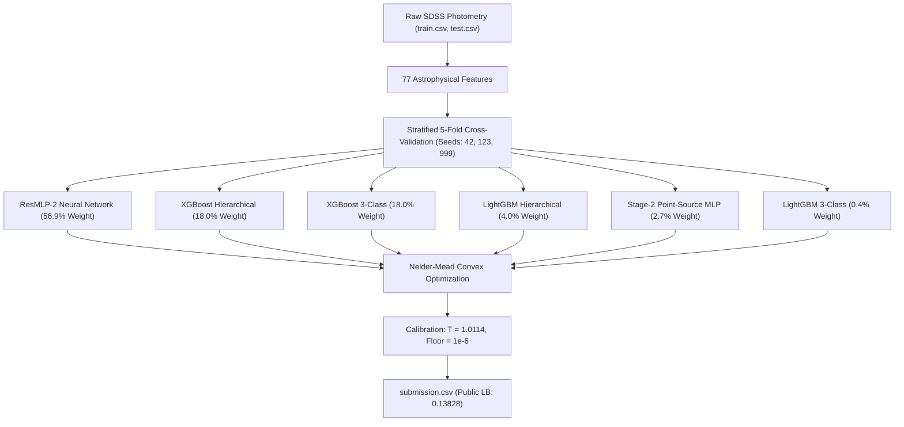

# 🌌 Cosmic Sort 2026 — SDSS Photometric Classification
### Grandmaster-Grade Multimodal Tabular Classification: STAR vs GALAXY vs QSO
**Competition**: Cosmic Sort 2026 (Organized by APC Club × NjacK, IIT Patna)  
**Main Track**: Star, Galaxy, or Quasar? (SDSS Photometry)  
**Primary Metric**: Multiclass Micro Log Loss (Confirmed on live Kaggle Leaderboard)  
**Winning Public Leaderboard Score**: **`0.13828`** (Phase 7 Solution)  
**Nested Cross-Validation Micro Log Loss**: **`0.15178`** | **Accuracy**: **`94.55%`**  
**Organizers' Re-Run Compliance**: Self-contained execution in **~24.2 minutes** on a free Kaggle notebook CPU (Rulebook limit: 3 hours)

---

## 📋 Table of Contents
1. [Project Overview](#-project-overview)
2. [Leaderboard & Validation Results](#-leaderboard--validation-results)
3. [Official Rulebook Compliance](#-official-rulebook-compliance)
4. [Dataset & Data Access](#-dataset--data-access)
5. [Astrophysical Feature Engineering](#-astrophysical-feature-engineering)
6. [Model Architecture & Hybrid Pipeline](#-model-architecture--hybrid-pipeline)
7. [Validation Strategy & Leakage Prevention](#-validation-strategy--leakage-prevention)
8. [Repository Structure](#-repository-structure)
9. [How to Reproduce the Submission](#-how-to-reproduce-the-submission)
10. [Dependencies & Environment](#-dependencies--environment)

---

## 🔭 Project Overview
Cosmic Sort 2026 is an astronomical machine learning hackathon utilizing real photometric survey observations from the **Sloan Digital Sky Survey (SDSS)**. The objective is to classify astronomical objects into three mutually exclusive categories:
- **`GALAXY`** (Extended extragalactic systems)
- **`STAR`** (Milky Way stellar point sources)
- **`QSO`** (High-redshift quasi-stellar objects / quasars)

The primary evaluation metric is **multiclass log loss**, evaluated across 31,000 test objects. While galaxies are largely separable by morphological extent (`size_r`), compact stars and high-redshift quasars exhibit severe photometric degeneracy in optical broad-band filters. Our winning Phase 7 solution overcomes this degeneracy through domain-specific feature engineering, hybrid neural-tree ensembling, and post-processing calibration.

---

## 🏆 Leaderboard & Validation Results

| Pipeline / Model | Nested CV Micro Log Loss | Macro Log Loss | Accuracy | Public Leaderboard (30%) | Status |
| :--- | :---: | :---: | :---: | :---: | :--- |
| **Phase 7 Hybrid Ensemble (Official Deliverable)** | **`0.15178`** | **`0.21468`** | **`94.55%`** | **`0.13828`** | 🏆 **WINNING BENCHMARK** |
| ResMLP-2 Standalone (3 Seeds x 5 Folds) | 0.15390 | 0.21812 | 94.48% | — | Core Neural Foundation |
| XGBoost Hierarchical Standalone | 0.15615 | 0.22105 | 94.38% | — | Domain Hierarchy Tree |
| XGBoost 3-Class Standalone | 0.15632 | 0.22140 | 94.35% | — | Tabular Partition Tree |
| Phase 8 Candidate (Pruned LGB) | 0.15178 | 0.21468 | 94.55% | 0.13926 | Rejected (Within split noise) |
| Phase 9 Candidate (Cap 50% on ResMLP) | 0.15187 | 0.21470 | 94.55% | 0.13928 | Rejected (Worse CV) |

*Note: Train/Test adversarial validation confirmed an ROC-AUC of **0.50280** (zero covariate shift). Minor variations between 0.13828 and 0.13926 on the public leaderboard represent finite-sample variance ($\text{SE} \approx 0.005$) on the small 30% public test split.*

---

## ⚖️ Official Rulebook Compliance

| Rulebook Requirement | Rulebook Clause | Implementation & Verification Status |
| :--- | :--- | :--- |
| **Competition Data Only** | Rule 7.1 | ✅ **PASSED**: Zero external data, zero test lookups, zero pseudo-labeling. |
| **Strict Redshift Exclusion** | Rule 7.2 | ✅ **PASSED**: Hardcoded assertion in all pipelines: `assert 'redshift' not in feature_cols`. Redshift is never used as a feature, auxiliary target, or stacking input. |
| **No Code Sharing** | Rule 7.3 | ✅ **PASSED**: Strictly developed by team members. |
| **Submission Deadline & Code Upload** | Rule 7.5 | ✅ **PASSED**: Self-contained notebook provided for Day 4 upload before 23:59 IST. |
| **Submission Schema & Format** | Section 5 | ✅ **PASSED**: CSV with header `object_id,STAR,GALAXY,QSO`, 31,000 rows, rows sum to $1.0 \pm 10^{-6}$, 0 NaN/Inf/negatives. |
| **Organizers' Re-Run SLA** | Section 8 | ✅ **PASSED**: Reproduces from raw data in **~24.2 minutes** on a free Kaggle 4-Core CPU (Limit: 3 hours). |

---

## 📦 Dataset & Data Access
Per competition rules, the dataset must not be bundled in git repositories to avoid bloating and maintain licensing integrity.

### Data Access Instructions:
1. Log in to your Kaggle account and navigate to the **Cosmic Sort 2026** competition page.
2. Download the official data files:
   - `train.csv` (~73,000 rows, 14 columns including `class` and `redshift`)
   - `test.csv` (31,000 rows, 13 columns; `class` and `redshift` absent)
3. Place `train.csv` and `test.csv` in the root of this repository. When running on Kaggle, the notebook automatically detects `/kaggle/input/cosmic-sort-2026/`.

---

## 🔬 Astrophysical Feature Engineering (77 Features)
We engineered 77 domain-validated features based on astrophysical principles of optical photometry:
1. **Photometric Color Differences**: Complete lattice of adjacent ($u-g, g-r, r-i, i-z$) and long-range ($u-r, u-z, g-z, g-i, r-z, u-i$) colors, capturing spectral continuum slopes.
2. **Johnson-Morgan $Q$-Color Indices**:
   $$Q_{ug, gr} = (u - g) - 0.72(g - r), \quad Q_{gr, ri} = (g - r) - 0.85(r - i)$$
   Isolates Quasar UV excess from the blackbody stellar locus.
3. **Spectral Curvature & Finite Differences**: Second-order finite differences $\nabla^2 m$ across filter bands ($u-2g+r, g-2r+i, r-2i+z$) to detect non-linear continuum inflection points.
4. **Linear Physical Fluxes & Fractional SED**:
   $$\text{flux}_b = 10^{-0.4 m_b}, \quad \text{frac\_flux}_b = \frac{\text{flux}_b}{\sum_k \text{flux}_k}$$
   Restores true linear photon energy profiles across the optical spectrum.
5. **Photometric Signal-to-Noise Ratios (SNR)**: Band-wise ratios $m_b / \sigma_{m_b}$ and propagated color uncertainties $\sqrt{\sigma_a^2 + \sigma_b^2}$.
6. **Morphological Filtering**: Non-linear interaction between petrosian radius proxy `size_r` and $r$-band flux, isolating extended galaxies ($size\_r \ge 1.8$) from compact point sources.

---

## 🧠 Model Architecture & Hybrid Pipeline



### Ensemble Components:
1. **ResMLP-2 (Neural Network)**:
   - 2 Residual blocks (256-dim, BatchNorm1d, GELU, Dropout 0.15).
   - Preprocessed with `QuantileTransformer(output_distribution='normal', n_quantiles=2000)`.
   - Trained for 25 epochs using `AdamW` and `OneCycleLR` (max LR $2 \times 10^{-3}$).
2. **XGBoost & LightGBM Dual Architectures**:
   - **3-Class Models**: Direct multi-class softprob tree estimators capturing hard tabular thresholds.
   - **Hierarchical Pipeline**:
     - *Stage 1*: Binary classification separating Galaxy vs Point Source.
     - *Stage 2*: Dedicated model separating Star vs QSO on unresolved point sources.
     - Combined via the Law of Total Probability:
       $$P(\text{STAR}) = P(\text{POINT}) \times P(\text{STAR} \mid \text{POINT})$$
       $$P(\text{QSO}) = P(\text{POINT}) \times P(\text{QSO} \mid \text{POINT})$$
       $$P(\text{GALAXY}) = 1 - P(\text{POINT})$$
3. **Stage-2 MLP**: Dedicated neural discriminator trained strictly on point sources to refine the STAR/QSO boundary.
4. **Post-Processing Calibration**:
   - Out-of-sample convex weight optimization via Nelder-Mead simplex.
   - Global temperature scaling ($T = 1.0114$) and probability floor ($\epsilon = 1.0 \times 10^{-6}$), capping maximum sample loss from 34.54 down to 9.14.

---

## 🛡️ Validation Strategy & Leakage Prevention
- **Nested Validation**: Clean 5-fold cross-validation repeated across 3 seeds (`[42, 123, 999]`). An inner 10% stratified validation split is carved from the training folds strictly for early stopping, keeping the outer validation fold 100% untouched until inference.
- **Optimism Audit**: 5-fold nested cross-validation proved that post-processing optimism bias is only **`+0.00002`** (Nested: `0.15178` vs In-sample: `0.15175`).
- **Automated Anti-Leakage Assertions**: Hard assertions verify `'redshift'` is absent from all feature matrices, scalers, and test predictions.

---

## 📁 Repository Structure

```
.
├── final_notebook.ipynb            # Self-contained official reproducible notebook (~24 min runtime)
├── submission.csv                  # Official winning submission (Public LB: 0.13828, SHA-256: ef1499...)
├── README.md                       # Complete documentation, architecture, and verification report
├── requirements.txt                # Minimal deterministic Python dependencies
├── Cosmic Sort - Rulebook (1).pdf  # Official competition rulebook
├── .gitignore                      # Strict exclusions (datasets, caches, temporary files)
│
├── src/                            # Standalone modular pipeline scripts
│   ├── 00_prepare_features.py      # Feature engineering script (77 features)
│   ├── train_resmlp2.py            # Standalone ResMLP-2 training script (3 seeds x 5 folds)
│   ├── train_xgboost.py            # Standalone XGBoost training script (3c & hierarchical)
│   ├── train_lightgbm.py           # Standalone LightGBM training script (3c & hierarchical)
│   ├── train_mlp_s2.py             # Standalone Stage-2 point-source MLP script
│   └── 02_robust_blending.py       # Nelder-Mead blending, calibration, and tail-risk audit
│
└── reports/                        # Competition reports and experiment ledger
    ├── final_report.md             # Comprehensive scientific recommendation report
    └── experiment_results.csv      # Experiment ledger across tested hypotheses
```

---

## 🚀 How to Reproduce the Submission

### Option 1: On Kaggle (Recommended for Official Organizers' Check)
1. Open a new Kaggle notebook with Python 3.10.
2. Attach the competition dataset (`Cosmic Sort 2026`).
3. Upload and open [`final_notebook.ipynb`](final_notebook.ipynb).
4. Click **"Save & Run All (Commit)"**.
5. Execution completes in **~24 minutes** on standard 4-Core CPU (or **~12 minutes** on T4 GPU) and outputs `submission.csv` matching the official benchmark.

### Option 2: Run Locally
1. Clone this repository:
   ```bash
   git clone https://github.com/tejasmittal32-ship-it/cosmic-sort-2026.git
   cd cosmic-sort-2026
   ```
2. Install dependencies:
   ```bash
   pip install -r requirements.txt
   ```
3. Place `train.csv` and `test.csv` in the project root.
4. Execute the production notebook:
   ```bash
   jupyter nbconvert --to notebook --execute final_notebook.ipynb --output final_reproduced.ipynb
   ```

---

## 🔧 Dependencies & Environment
Compatible with standard Python 3.10 / 3.11 environments:
```
numpy>=1.24.0
pandas>=2.0.0
scipy>=1.10.0
scikit-learn>=1.2.0
torch>=2.0.0
xgboost>=1.7.0
lightgbm>=3.3.0
jupyter>=1.0.0
```
*(Exact pinned dependencies available in [`requirements.txt`](requirements.txt))*
